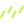
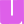
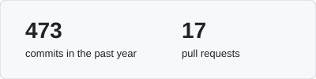
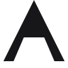

# Tech Stack

## Languages

&nbsp;&nbsp;&nbsp;&nbsp;&nbsp;&nbsp;&nbsp;&nbsp;&nbsp;

## Frameworks & Libraries

&nbsp;&nbsp;&nbsp;&nbsp;&nbsp;&nbsp;&nbsp;&nbsp;&nbsp;&nbsp;&nbsp;&nbsp;&nbsp;&nbsp;&nbsp;&nbsp;&nbsp;&nbsp;&nbsp;&nbsp;&nbsp;&nbsp;&nbsp;&nbsp;&nbsp;&nbsp;&nbsp;

## Infrastructure

&nbsp;&nbsp;&nbsp;&nbsp;&nbsp;&nbsp;&nbsp;&nbsp;&nbsp;&nbsp;&nbsp;&nbsp;&nbsp;&nbsp;&nbsp;&nbsp;&nbsp;&nbsp;

## Tooling

&nbsp;&nbsp;&nbsp;&nbsp;&nbsp;&nbsp;&nbsp;&nbsp;&nbsp;&nbsp;&nbsp;&nbsp;&nbsp;&nbsp;&nbsp;&nbsp;&nbsp;&nbsp;&nbsp;&nbsp;&nbsp;&nbsp;&nbsp;&nbsp;

# Contributions

## Open Source

- **AUR maintainer:** [gogcli](https://aur.archlinux.org/packages/gogcli), [gogcli-bin](https://aur.archlinux.org/packages/gogcli-bin), [omnidb-app](https://aur.archlinux.org/packages/omnidb-app), [omnidb-bin](https://aur.archlinux.org/packages/omnidb-bin), [omnidb-server-bin](https://aur.archlinux.org/packages/omnidb-server-bin), and [pgbot-bin](https://aur.archlinux.org/packages/pgbot-bin).
- **[recol](https://github.com/nlkli/recol):** Added Kitty terminal support and documented its automatic config reload. [PR #3](https://github.com/nlkli/recol/pull/3) · [PR #4](https://github.com/nlkli/recol/pull/4)
- **[DumbBudget](https://github.com/DumbWareio/DumbBudget):** Added Pakistani rupee (PKR) currency support. [PR #47](https://github.com/DumbWareio/DumbBudget/pull/47)

# Links

  &nbsp;&nbsp;&nbsp;
  &nbsp;&nbsp;&nbsp;
  &nbsp;&nbsp;&nbsp;
  &nbsp;&nbsp;&nbsp;
  &nbsp;&nbsp;&nbsp;
  

